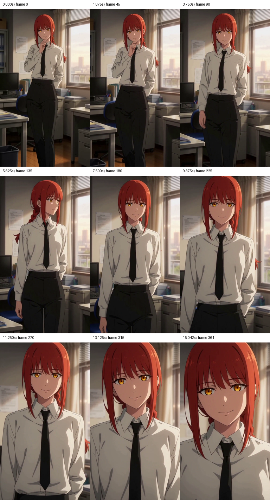

# MiniMax H3 on 24GB GPUs

[简体中文](README.zh-CN.md) · [Benchmarks](benchmarks/README.md) · [Setup](docs/setup.md)

Run MiniMax H3 with two or four RTX 3090s. This repository brings together FL2VA Larry Turbo, Ref2VA Turbo/PDD, multi-GPU launchers, memory optimizations, and measured video outputs.

**15-second video with native stereo audio:** FL2VA six-step generation takes **9:29 including loading** on four cards; Ref2VA PDD eight-step generation takes **11:19**.

## Results

INT8 ConvRot pruned backbone, SageAttention 2, 362 frames at 24 fps. DiT weights stay on the GPUs during denoising.

| Task | GPUs | Steps | Denoising | Framework total | Video |
|---|---:|---:|---:|---:|---|
| FL2VA · Larry Turbo | 2 | 6 | 656.49 s | 806.85 s | [Play](media/fl2va-turbo-2gpu.mp4) |
| FL2VA · Larry Turbo | 4 | 6 | **450.77 s** | **568.95 s** | [Play](media/fl2va-turbo-4gpu.mp4) |
| Ref2VA · PDD | 2 | 8 | 838.13 s | 952.81 s | [Play](media/ref2va-pdd-2gpu.mp4) |
| Ref2VA · PDD | 4 | 8 | **571.82 s** | **678.55 s** | [Play](media/ref2va-pdd-4gpu.mp4) |

FL2VA: 1344×768, first-frame conditioning. Ref2VA: 768×1344, image-reference conditioning. Each two/four-GPU pair uses the same input and seed. Framework total includes loading, encoding, denoising, decoding, and saving; weights and caches are prepared beforehand.

[](media/fl2va-turbo-4gpu.mp4)

[](media/ref2va-pdd-4gpu.mp4)

## Quick start

Linux, CUDA, and two or four NVIDIA GPUs. The measured environment uses PyTorch 2.5.1 + CUDA 12.4 and SageAttention 2.2.0.

```bash
git clone https://github.com/torenyx/minimax-h3-inference-lab.git
cd minimax-h3-inference-lab
bash scripts/setup.sh
source .venv/bin/activate
```

FL2VA Larry Turbo, two GPUs:

```bash
python scripts/run.py \
  --profile fl2va-turbo --gpus 2 \
  --model-dir /models/h3/fl2va \
  --pruned-checkpoint /models/h3/fl2va/pruned_int8_convrot.safetensors \
  --adapter /models/h3/larry-v4_step600_ema.safetensors \
  --embedding-grid /models/h3/h3_silu_temb_grid.safetensors \
  --prompt-file examples/prompt.txt --image /inputs/first-frame.png \
  --output-dir outputs/fl2va
```

Use `--gpus 4` for TP2×SP2. Ref2VA PDD uses `--profile ref2va-pdd` with the Ref2VA backbone and its PDD adapter; Ref2VA Turbo uses `--profile ref2va-turbo` with the matching LightX2V eight-step adapter.

Model layout, weight preparation, and reusable path settings: [setup guide](docs/setup.md).

## What changes the runtime

- **Resident denoising.** TP2 on two cards; TP2×SP2 on four. Release DiT after sampling to make room for the VAEs.
- **Smaller temporary tensors.** Chunk FFN, RMSNorm, AdaLN, and LoRA updates; release Q/K/V and communication buffers after use.
- **Prepared loading.** Persist TP2 INT8 shards and AdaLN schedules, then reuse node-local weights and components.
- **Parallel decoding.** Spatially tile video-VAE work across GPUs and decode native audio separately.

For Ref2VA PDD on the same two cards, the resident configuration reduces denoising from **892.41 to 838.13 seconds** and framework total from **1052.08 to 952.81 seconds**. Four-card denoising takes 571.82 seconds. See [measurements](benchmarks/README.md).

## Base across four frameworks

Ref2VA, pruned INT8 ConvRot, SageAttention 2, 768×1344, 124 frames, 20 denoiser evaluations. Values below are denoising seconds.

| Framework | 2 GPUs | 4 GPUs |
|---|---:|---:|
| LightX2V | 417.30 | 353.87 |
| SGLang | 425.18 | 317.62 |
| Raylight | 594.54 | 362.62 |
| vLLM-Omni | ~590 | ~401 |

Launch code in this release targets LightX2V. The framework comparison data records each backend's parallel and residency configuration in [JSON](benchmarks/base-frameworks.json).

## More configurations

Ref2VA eight-step runs also cover full BF16 and pruned INT8 backbones:

| Adapter | Backbone | Denoising | Framework total |
|---|---|---:|---:|
| LightX2V Turbo | BF16 | 229.15 s | 376.15 s |
| LightX2V Turbo | INT8 pruned | 191.14 s | 515.04 s |
| PDD | BF16 | 226.92 s | 376.20 s |
| PDD | INT8 pruned | 191.57 s | 495.03 s |

Two RTX 3090s, 768×1344, 124 frames. [Turbo video](media/ref2va-turbo-int8-2gpu-5s.mp4) · [CSV](benchmarks/successful-runs.csv) · [JSON](benchmarks/successful-runs.json)

The [benchmark inputs](benchmarks/inputs/) and [per-step records](benchmarks/records/) accompany the clips.

## Built on

[MiniMax H3](https://github.com/MiniMax-AI/MiniMax-H3), [LightX2V](https://github.com/ModelTC/LightX2V), [Larryvrh Turbo](https://huggingface.co/larryvrh/MiniMax-H3-Turbo-Lora), [Alibaba PAI PDD](https://huggingface.co/alibaba-pai/MiniMax-H3-Acc-LoRAs), [VideoX-Fun](https://github.com/aigc-apps/VideoX-Fun), and [SageAttention](https://github.com/thu-ml/SageAttention).

Base measurements include [SGLang](https://github.com/sgl-project/sglang), [Raylight](https://github.com/komikndr/raylight), and [vLLM-Omni](https://github.com/vllm-project/vllm-omni).

Rank-8 time-conditioning preparation follows [Wan2GP](https://github.com/deepbeepmeep/Wan2GP).
